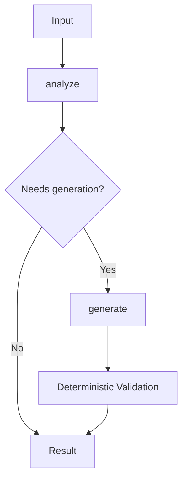

# LLM Orchestration Guide

**Keep LLM calls minimal, prompts explicit, and multi-call workflows easy to trace.**

This guide complements [`llm-contracts.md`](llm-contracts.md). That guide covers LLM input/output ownership and structured contracts. This guide covers call placement, prompt ownership/composition, and orchestration visibility.

## 1. Core invariants

For any feature that uses an LLM:

1. **Use an LLM only for genuine inferential work.**
2. **Keep handlers thin.** No prompt bodies or multi-call flow in handlers.
3. **Store prompts as named artifacts under the owning module's `Prompt/` directory.**
4. **Make prompt composition explicit in orchestration code.**
5. **Document the active prompt graph in `Prompt/README.md`, preferably with Mermaid.**
6. **Do not create hidden prompt chains or implicit prompt dependencies.**
7. **Keep deterministic routing, formatting, validation, merging, and state transport in code.**

If a real provider or semantic constraint requires an exception, document why.

## 2. Minimize LLM responsibility

Do not optimize only for call count. Minimize the work that must depend on an LLM.

Use LLMs for semantic work such as classification, extraction from unstructured content, semantic matching, summarization, judgment, and natural-language generation.

Use deterministic code for known-value transport, IDs/timestamps/counts, fixed mappings, DTO reshaping, schema validation, deterministic formatting/routing, and mechanical transformation of structured outputs.

For schema ownership and repeated-context rules, also follow [`llm-contracts.md`](llm-contracts.md).

## 3. Keep handlers thin

A handler should normally do only boundary work:

```text
Handler
  → boundary validation
  → use case / orchestration
  → response mapping
```

Do not put prompt bodies, prompt composition, multi-call sequencing, semantic routing, model/provider policy, retry/fallback orchestration, or model-output reconciliation in handlers.

Reuse an existing LLM/provider boundary before adding another wrapper.

## 4. Orchestration owns execution flow

For multi-step workflows, orchestration code is the canonical source of truth for order and branching.

```text
Handler
  ↓
Deterministic Orchestration
  ├─ Prompt A → LLM
  ├─ validation / deterministic processing
  ├─ Prompt B → LLM
  └─ merge / validation
  ↓
Result
```

Avoid model-to-model chains whose control flow is not visible in application code.

Every LLM call should clearly define:

- its semantic task;
- its named prompt artifact;
- required context;
- owned inferential output;
- validation point;
- data passed to the next step.

## 5. Prompt ownership and composition

Do not scatter prompt strings across handlers, services, or orchestration files.

```text
SomeModule/
├── handler/
├── orchestration/
│   └── some_workflow.*
└── Prompt/
    ├── README.md
    ├── analyze.*
    ├── classify.*
    └── generate.*
```

Each prompt should have one clear owning module, a descriptive name, one semantic responsibility, and a traceable consumer.

Do not create shared prompts merely for convenience. Share only when multiple real consumers have the same semantic responsibility.

Prompts should be decomposable and composable, but decomposition is not a goal by itself. Split by semantic responsibility, not arbitrary text fragments.

Prefer:

```text
analyze_source
classify_intent
generate_response
```

Avoid fragment sets such as:

```text
base
common
rules
format
extra_rules
final_suffix
```

Composition rules:

- compose prompts explicitly in orchestration code;
- make every prompt-to-prompt transition semantically explainable;
- use deterministic transformation instead of an extra LLM call when possible;
- do not duplicate instructions without a reason;
- do not let multiple prompts independently own the same inferred fact;
- do not abstract fragments before there is real reuse.

## 6. `Prompt/README.md` is the orchestration view

Every module with LLM orchestration should keep a `Prompt/README.md` that reflects the active prompt graph.

The README is not the runtime source of truth. Orchestration code is canonical; the README is its human-reviewable view.

At minimum, document active prompt artifacts, responsibilities, call order, branches, and deterministic validation/processing between calls.



When prompts, order, or branches change, update `Prompt/README.md` in the same change.

## 7. Model-driven routing and loops

Let the model choose the next step only when routing itself requires semantic inference. If known state or deterministic rules are enough, route in code.

When model-driven routing or an agent loop is necessary, define:

- the named routing prompt;
- allowed structured routing outputs;
- validation/fallback behavior;
- allowed next steps;
- termination conditions;
- a bounded call/retry policy.

"The agent decides what to do next" is not a sufficient contract.

## 8. Verification

Before completing an orchestration change, verify:

1. Every LLM call performs genuine inferential work.
2. Handlers contain no prompt bodies or multi-call control flow.
3. Every call maps to a named artifact under `Prompt/`.
4. Prompt responsibilities do not overlap without a documented reason.
5. Composition is explicit in orchestration code.
6. Structured outputs follow [`llm-contracts.md`](llm-contracts.md).
7. `Prompt/README.md` matches the actual flow.
8. Removed prompts or calls leave no orphan references.

Investigate these red flags before completion: prompts embedded in handlers; duplicated prompts; hidden string-concatenation chains; model-to-model routing without a contract; README/runtime drift; meaningless prompt fragmentation; one model call merely reformatting another; deterministic state carried through model chains; or several calls independently inferring the same fact.

---

**These guidelines are working if:** handlers stay thin, LLM calls are limited to real inference, every call maps to a named prompt artifact, and the workflow can be understood quickly from code plus `Prompt/README.md`.
